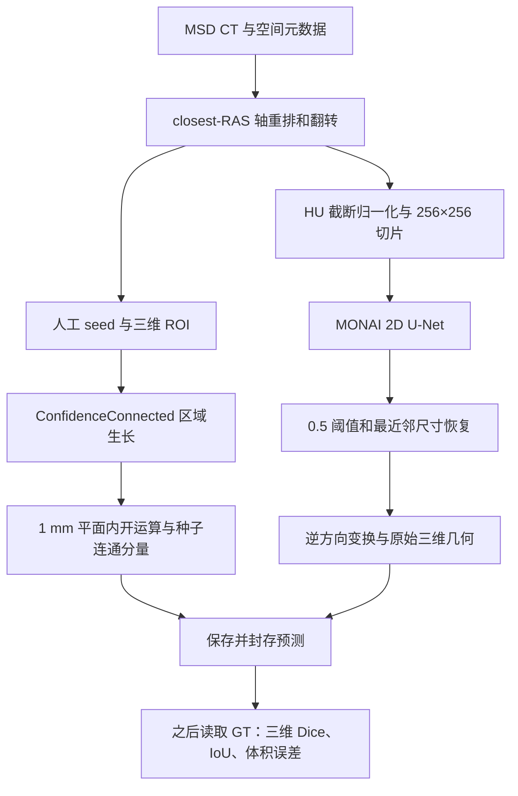
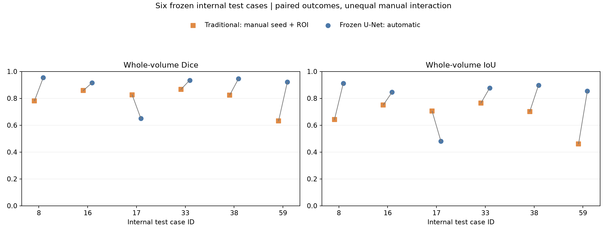
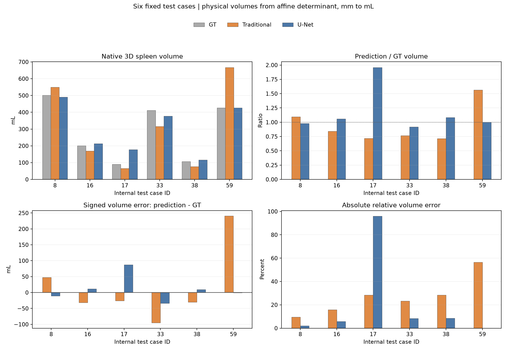

# CT 脾脏分割：传统半自动方法与 MONAI 2D U-Net

数字图像处理课程项目。基于 MSD Task09 Spleen，完成 CT 空间处理、传统半自动分割、轻量级 U-Net、训练策略对照、原始三维空间评价和体积分析。Stage 1–8 已完成，本仓库整理必要代码与封存实验成果；不包含原始影像、NIfTI 掩膜、模型权重或原开发仓库的 Git 历史。

传统方法需要人工 CT-only **seed 和三维 ROI**；U-Net 为模型冻结后的 **CT-only 自动推理**。六例内部留出测试仅作描述性比较，不代表临床验证或统计上的普遍优势。

## 技术路线



共享空间处理见 `src/common/io_spatial.py`；传统方法见 `src/common/traditional_segmentation.py` 和 `src/common/region_postprocess.py`；U-Net 见 `src/unet_data.py`、`src/unet_pipeline.py`、`src/unet_schedule.py`。

## 数据来源与划分

数据为 [Medical Segmentation Decathlon](http://medicaldecathlon.com/) Task09 Spleen。下载脚本使用 [MONAI 数据镜像](https://msd-for-monai.s3-us-west-2.amazonaws.com/Task09_Spleen.tar)，核对 MD5 `410d4a301da4e5b2f6f86ec3ddba524e`。数据登记采用 CC BY-SA 4.0，需署名、链接许可证并说明衍生处理，详见 [数据许可与署名](docs/DATA_LICENSE_AND_ATTRIBUTION.md)。原始 CT、GT 和压缩包不随仓库发布。

41 例带标签数据固定为 **29 train / 6 val / 6 test**，seed=42，见 `data/cases.csv` 与冻结的 `data/split.json`。内部 test 为 `spleen_8、16、17、33、38、59`，不是官方无标签 `imagesTs` 的 20 例。集合间 case ID 无交集，但身份元数据不足以独立确认患者身份及重复扫描问题。传统预测早于正式冻结标记，不能称为预注册测试。

## 方法和训练配置

传统基线在人工 seed/ROI 内执行 SimpleITK ConfidenceConnected（邻域半径 1、迭代 2、multiplier=2.0），再做 1 mm 平面内开运算和种子连通分量。分割不读取 GT。人工交互使其与自动 U-Net 的比较条件不同。

MONAI 二维 U-Net：channels=`(16,32,64,128,256)`、strides=`(2,2,2,2)`、`num_res_units=2`。CT 做 closest-RAS 变换，HU 截断至 `[-57,164]` 后归一化，全部切片线性缩放至 256×256；GT 最近邻变换。推理在 256 网格以 sigmoid ≥0.5 二值化，再最近邻恢复尺寸与原始方向，不加 U-Net 后处理。

训练使用 Adam、学习率 0.001、batch size 4、num_workers=0、0.5 Dice + 0.5 BCE loss、AMP、seed=42。Stage 6 从 Epoch 9 分叉，仅改变完整 mini-batch 执行顺序（独立 schedule seed=600042）。Stage 7 从 Epoch 14 严格续训，patience=10、min_delta=0.0001、上限 50 epochs，实际 Epoch 27 停止。按六例 val mean Dice 选择 **Epoch 17**（val Dice=0.890505），不是最后一个 checkpoint。配置见 `configs/train_unet_stage7_final_candidate.yaml`。

批次打乱未解决全部不稳定问题：Epoch 20 曾出现六例验证预测全空。证据见 [训练策略与稳定性说明](docs/TRAINING_STRATEGY.md)。

## 六例内部独立测试

原始三维空间逐病例计算后等权平均；± 为样本标准差（ddof=1），不是置信区间。

| 指标 | 传统半自动（后处理） | U-Net Epoch 17 |
|---|---:|---:|
| Mean Dice | 0.797899 ± 0.086963 | **0.886920 ± 0.117216** |
| Mean IoU | 0.670456 | **0.811181** |
| 平均绝对体积误差 | 78.716 mL | **25.493 mL** |

| 病例 | 传统 Dice | U-Net Dice |
|---|---:|---:|
| spleen_8 | 0.781426 | 0.953598 |
| spleen_16 | 0.857499 | 0.916214 |
| spleen_17 | **0.826567** | 0.649430 |
| spleen_33 | 0.866215 | 0.934952 |
| spleen_38 | 0.824503 | 0.946209 |
| spleen_59 | 0.631187 | 0.921120 |

U-Net 在 5/6 例 Dice 更高；`spleen_17` 明显过分割：预测 177.661 mL、GT 90.657 mL，RAVE=95.972%。该例完整保留，未按 test 调整模型、阈值或后处理。详见 [最终报告](docs/FINAL_REPORT.md) 和 [公开结果 CSV](results/unet_stage8_final_test/)。

## 实际可视化

训练与验证曲线（保留退化阶段）：


表现较好例 `spleen_8`：U-Net Dice=0.953598、RAVE=2.106%；过分割失败例 `spleen_17`：Dice=0.649430、RAVE=95.972%。传统方法在后者更好。CT/GT/预测三方向对比图已准备，但仍在公开目录外等待授权与人工隐私确认；当前版本只显示统计图，不以少数图像替代六例完整结果。



三维体积和误差：



以上统计图直接复制自封存成果，未重画或重算。全部六例、失败案例和三维数值见 [最终报告](docs/FINAL_REPORT.md)。待批准 CT 图的切片按各方向 GT 面积最大值事后选取，仅用于展示，不参与推理或 ROI 决策。

## 三维体积与指标

预测还原至原始三维空间后，体素体积为 `abs(det(affine[:3,:3]))`，按 NIfTI 空间单位换算到 mm³；脾脏体积 mL=`前景体素数 × 体素体积 / 1000`。Dice=`2TP/(2TP+FP+FN)`，IoU=`TP/(TP+FP+FN)`；体积误差为预测体积减 GT，RAVE=`100 × |预测−GT| / GT`。病例级等权平均避免大体积病例支配结果，总体积相近也不能证明分割轮廓正确。

## 环境和使用

最终实验环境：Python 3.11.17、PyTorch 2.8.0+cu126、MONAI 1.6.1、NumPy 2.4.6、SciPy 1.17.1、NiBabel 5.4.2、SimpleITK 2.5.6、Matplotlib 3.11.2、PyYAML 6.0.3，GPU 为 RTX 4060 Laptop GPU。先为设备安装适用的 PyTorch，再安装依赖：

```powershell
python -m pip install -r requirements-unet.txt
python scripts/download_msd_spleen.py --output-dir data/raw
```

数据布局为 `data/raw/Task09_Spleen/{imagesTr,labelsTr,imagesTs}`。保持冻结的 manifest/split，不重新划分。

以下示例从项目根目录运行。请先自行取得 MSD 数据；U-Net 推理还需匹配的完整 checkpoint。**本仓库没有公开 Epoch 17 checkpoint，下载仓库后不能直接复现该模型的最终推理。**训练入口记录 Git 来源，需要已有首个提交的 Git 工作副本。

```powershell
# spleen_2 已核实属于冻结 train 集；需自行获得匹配的完整 checkpoint。
python scripts/predict_unet.py --checkpoint outputs/unet_runs/unet_stage7_global_batch_shuffle_seed42/best.pt --image data/raw/Task09_Spleen/imagesTr/spleen_2.nii.gz --output-dir outputs/local_inference_example --device cuda --batch-size 4

# 从头训练示例，不会重现历史分阶段续训轨迹。
python scripts/train_unet.py --config configs/train_unet_stage7_final_candidate.yaml --output-dir outputs/unet_runs/local_reproduction
```

精确重建 Epoch 17 需要匹配 checkpoint、分阶段续训链、源文件字节、环境与冻结划分；从头套用最终配置不能保证复现封存数值。原最终测试依赖未公开的封存链、掩膜和历史材料，因此该一次性测试驱动未纳入公开目录；通用推理与评价入口仍提供。本次没有重新执行训练或独立测试。见 [公开复现说明](docs/REPRODUCIBILITY.md)。

## 模型和局限

当前不发布 checkpoint。Epoch 17 `best.pt` 为 19,615,937 字节（约 18.707 MiB），包含模型、Adam、AMP scaler、RNG、训练历史和来源信息；模型张量约 6.20 MiB。SHA-256：`966a5e59e57d82bd9813ea411735b82256fe6be7114af2d9cde655684d6bfee4`。运行最终 Epoch 17 推理需要自行获得相应完整 checkpoint；自行训练也可得到同架构权重，但不保证得到同一模型或封存指标。当前脚本不直接接受裸 state_dict。

仅六例内部 test、一个模型随机种子，且多次使用同一 val 选模；没有外部或临床验证、显著性证据或完整人工交互成本研究。二维缩放有信息损失，训练存在退化阶段，GT 也有标注不确定性。未来根据这些 test 发现改进时必须说明探索性质，不能继续将同一六例作为未见确认性测试。

## 传统方法与评价入口

从项目根目录运行；以下示例使用冻结 train 集病例 `spleen_2`：

```powershell
# 仅显示 CT，人工选择 seed/ROI；需桌面交互环境。
python scripts/select_seed_roi.py --data-root data/raw/Task09_Spleen --case-id spleen_2 --output-json outputs/local_selection/spleen_2_seed_roi.json
python scripts/run_traditional_v2.py --data-root data/raw/Task09_Spleen --case-id spleen_2 --seed-roi-json outputs/local_selection/spleen_2_seed_roi.json --output-dir outputs/local_traditional
# 通用评价示例；不要用它重跑已封存六例测试。
python scripts/evaluate.py --gt data/raw/Task09_Spleen/labelsTr/spleen_2.nii.gz --pred outputs/local_traditional/spleen_2/traditional_mask.nii.gz --case-id spleen_2 --method traditional --output-csv outputs/local_evaluation/spleen_2.csv
```

公开测试只用合成数据，不依赖旧提交或真实 checkpoint：

```powershell
python -B -m unittest discover -s tests -t . -v
```

完整文件清单与 SHA-256 见 [PUBLIC_FILES.json](PUBLIC_FILES.json)。项目原创代码采用 [MIT License](LICENSE)，贡献分工见 [CONTRIBUTORS.md](CONTRIBUTORS.md)。MSD 数据及本仓库标记的数据衍生材料采用 CC BY-SA 4.0；PyTorch、MONAI、SimpleITK 等依赖分别遵循各自许可证。适用范围与第三方说明见 [NOTICE.md](NOTICE.md) 和 [数据许可与署名](docs/DATA_LICENSE_AND_ATTRIBUTION.md)。
