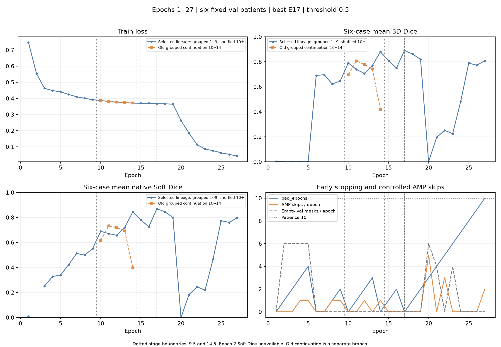
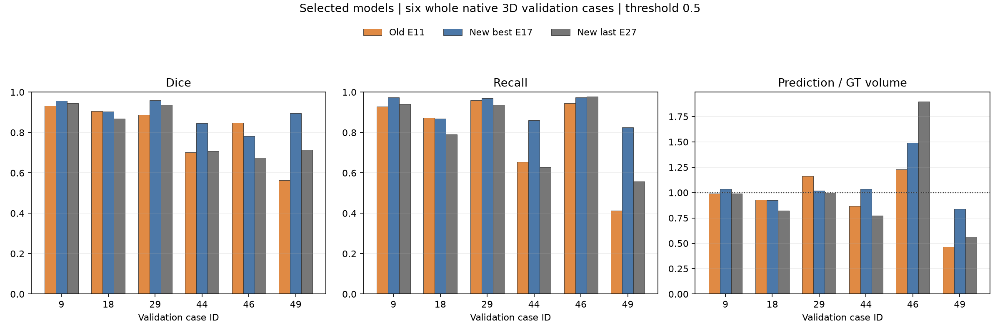

# 训练策略与稳定性

本说明整理已有 Stage 4–8 记录，不增加实验或改变结论。

- 基础网络为 MONAI 2D U-Net：channels=(16,32,64,128,256)、strides=(2,2,2,2)、num_res_units=2。
- Adam，lr=0.001，batch size=4，num_workers=0，0.5 Dice + 0.5 BCE，AMP，seed=42。使用全部切片，没有以测试 GT 决定采样、阈值或后处理。
- Stage 4–5 按患者分组训练。原顺序在 E11 val Dice=0.806528，E14 降至0.418254，表明均值会明显退化。
- Stage 6 从完成的 E9 分叉，只改变完整 mini-batch 的执行顺序。独立 schedule seed=600042，保留患者内 batch 成员、尾批和切片覆盖；不重新拼 batch、不丢尾批。
- Stage 7 从 E14 严格续训，上限50 epochs、patience=10、min_delta=0.0001。按六例 val mean Dice 保存 best；min_delta 仅影响 patience。E17 best Dice=0.890504926，E27 停止。
- E20 六例验证预测全部为空，Soft Dice 约0.000065，并有5次受控 AMP skip；后续部分恢复。不能把批次打乱表述为解决全部不稳定或证明根因。
- Stage 8 冻结 E17，不使用 E27 last；自动 CT-only 推理，全部预测保存并封存后才读取测试 GT，未对 test 调参。

配置位于 configs，原训练 CSV 位于 results/unet_training_history。模型结构和实现保持原始字节；本次仅筛选公开材料。

曲线和选择只说明本项目一次训练轨迹，不能从六例内部测试推断因果或普遍泛化优势。
